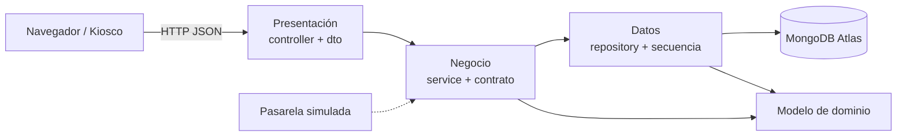
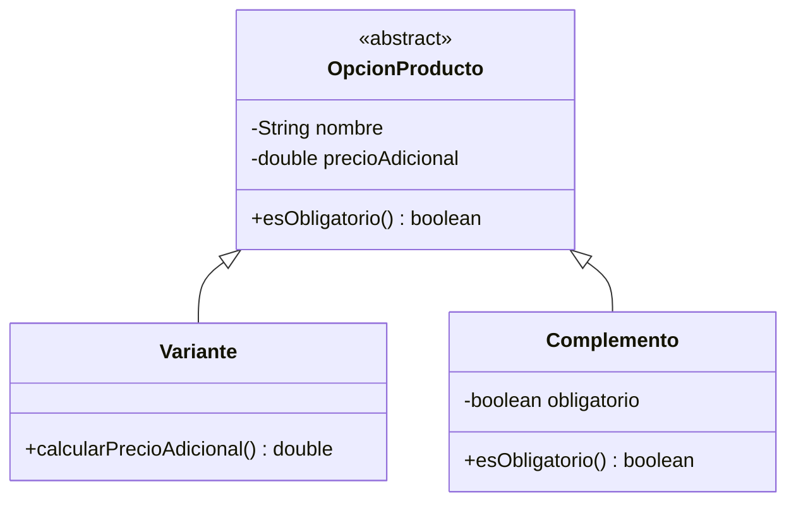
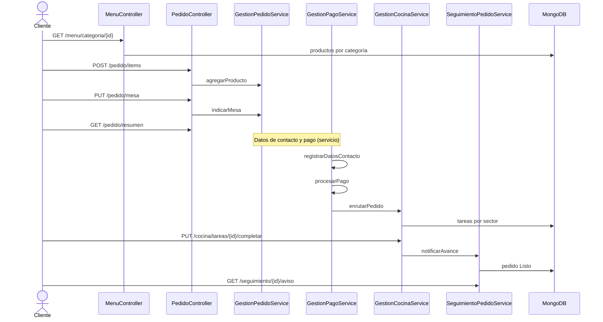

# Explicación detallada del código — RestSmart

Este documento explica **todo** el código del proyecto `restsmart/`: qué hace cada capa, cada clase y cada método, cómo se conectan entre sí, qué reglas de negocio implementa y cómo se relaciona con los diagramas UML. Al final incluye un guion de preguntas y respuestas para exponerlo.

---

## 1. Qué es el proyecto

Backend del **Sistema de Autoservicio para Restaurante RestSmart**. Implementa los flujos de menú, pedido, pago simulado, cocina por sectores, seguimiento del pedido y administración del menú.

| Aspecto | Decisión |
|---|---|
| Lenguaje | Java 21 |
| Framework | Spring Boot 4.2.0 (solo Spring Boot) |
| Persistencia | Spring Data MongoDB sobre MongoDB Atlas |
| Build | Maven Wrapper (`mvnw`) |
| API | REST con JSON |
| Autenticación | No incluida (no está en los diagramas) |

Dependencias usadas: `spring-boot-starter-webmvc`, `spring-boot-starter-data-mongodb` y `spring-boot-starter-validation`. No se usa Lombok, MapStruct, Swagger ni ningún framework adicional.

---

## 2. Arquitectura general

El sistema respeta las cuatro capas de la **vista de desarrollo**:



Regla de dependencia: **hacia adentro**. La presentación conoce al negocio, el negocio conoce a los datos y el dominio; el dominio no conoce a nadie.

### Estructura de paquetes

```
com.restsmart
├── RestsmartApplication.java          # Punto de arranque
├── presentacion
│   ├── controller                     # 5 controladores REST
│   └── dto                            # SeleccionOpcionesRequest
├── negocio
│   ├── service                        # 6 servicios
│   └── contrato                       # 5 interfaces provistas
├── datos
│   ├── repository                     # 5 repositorios MongoDB
│   └── secuencia                      # GeneradorSecuencia (IDs Integer)
└── modelo
    └── dominio                        # Entidades y objetos de valor
        └── enumeracion                # 5 enumeraciones
```

---

## 3. Capa de presentación

Los controladores son **delgados**: reciben HTTP, construyen los objetos mínimos del dominio y delegan en el servicio. No contienen reglas de negocio.

### 3.1 `MenuController` (`/menu`)

| Método | Ruta | Qué hace |
|---|---|---|
| `listaMenuPorCategoria` | `GET /menu/categoria/{categoriaId}` | Construye una `Categoria` con el id y pide al servicio los productos activos de esa categoría |
| `verDetalleProducto` | `GET /menu/producto/{id}` | Pide el producto por id |
| `SeleccionarOpciones` | `POST /menu/producto/{id}/opciones` | Valida que la variante/complementos elegidos sean válidos |
| `calcularPrecioItem` | `POST /menu/producto/{id}/precio` | Calcula el precio base + variante + complementos |

Ejemplo de cuerpo para las dos últimas rutas:

```json
{
  "variante": { "nombre": "Doble", "precioAdicional": 5000 },
  "complementos": [
    { "nombre": "Queso", "precioAdicional": 2000, "obligatorio": false }
  ]
}
```

### 3.2 `PedidoController` (`/pedido`)

| Método | Ruta | Qué hace |
|---|---|---|
| `agregarProducto` | `POST /pedido/items?productoId=&cantidad=` | Agrega al carrito; el cuerpo opcional lleva variante/complementos |
| `modificarCantidad` | `PUT /pedido/items/{itemId}/cantidad?cantidad=` | Cambia la cantidad del ítem |
| `quitarItem` | `DELETE /pedido/items/{itemId}` | Elimina el ítem del carrito |
| `indicarMesa` | `PUT /pedido/mesa?numeroMesa=` | Busca la mesa por número y la asocia al pedido en curso |
| `verResumenPedido` | `GET /pedido/resumen` | Devuelve el carrito con totales recalculados |
| `cancelarPedido` | `DELETE /pedido/{pedidoId}` | Cancela un pedido solo si aún no fue pagado |

### 3.3 `CocinaController` (`/cocina`)

| Método | Ruta | Qué hace |
|---|---|---|
| `verTareasSector` | `GET /cocina/tareas?sector=` | Tareas pendientes del sector |
| `verDetalleTarea` | `GET /cocina/tareas/{tareaId}` | Detalle de una tarea |
| `marcarTareaCompletada` | `PUT /cocina/tareas/{tareaId}/completar` | Marca la tarea y **notifica a seguimiento** |
| `verHistorialTurno` | `GET /cocina/historial?sector=` | Tareas completadas del sector |

`marcarTareaCompletada` invoca a `SeguimientoController` después de completar, tal como muestra la vista de desarrollo.

### 3.4 `SeguimientoController` (`/seguimiento`)

| Método | Ruta | Qué hace |
|---|---|---|
| `consultarEstado` | `GET /seguimiento/{pedidoId}/estado` | Devuelve el `EstadoPedido` |
| `verAvisoPedidoListo` | `GET /seguimiento/{pedidoId}/aviso` | Indica si el cliente debe ver el aviso de “pedido listo” |

### 3.5 `AdministracionMenuController` (`/admin/productos`)

| Método | Ruta | Qué hace |
|---|---|---|
| `crearProducto` | `POST /admin/productos?nombre=&precio=&categoria=&sector=` | Crea un producto activo |
| `modificarPrecioYDescripcion` | `PUT /admin/productos/{id}/precio?precio=&descripcion=` | Actualiza precio y descripción |
| `desactivarProducto` | `DELETE /admin/productos/{id}` | Pone `activo = false` |
| `asignarSectorCocina` | `PUT /admin/productos/{id}/sector?sector=` | Cambia el sector de preparación |

### 3.6 `SeleccionOpcionesRequest` (DTO)

`record` de presentación con dos campos concretos (`Variante` y `List<Complemento>`). Existe para que Jackson pueda enlazar el JSON sin tener que instanciar la clase abstracta `OpcionProducto`.

---

## 4. Capa de negocio

### 4.1 Contratos (`negocio.contrato`)

Interfaces provistas por los componentes de la **vista funcional**. Son marcadores: la vista funcional no les define operaciones, así que las operaciones viven en los servicios.

| Contrato | Implementado por |
|---|---|
| `iConsultaMenu` | `GestionMenuService` |
| `iAdministrarCatalogo` | `GestionMenuService` |
| `iProcesarPago` | `GestionPagoService` |
| `iNotificarAvanceCocina` | `GestionCocinaService` |
| `iConsultarEstado` | `SeguimientoPedidoService` |

`iPasarelaPago` está en `modelo.dominio` porque el diagrama de clases la ubica como sistema externo del dominio.

### 4.2 `GestionMenuService`

| Método | Lógica |
|---|---|
| `listarPorCategoria(Categoria)` | Valida que exista la categoría y devuelve los productos con `estadoDisponible()` y la misma categoría |
| `obtenerDetalleProducto(Producto)` | Busca por id; si no existe lanza `IllegalArgumentException` |
| `validarSeleccion(Producto, List<OpcionProducto>)` | Separa variante y complementos y delega en `Producto.validarSeleccion` |
| `calcularPrecioItem(Producto, List<OpcionProducto>)` | Separa variante y complementos y delega en `Producto.calcularPrecioItem` |

### 4.3 `GestionPedidoService`

Mantiene **un carrito activo en memoria** (kiosco) y la mesa seleccionada.

| Método | Lógica |
|---|---|
| `agregarProducto` | Valida producto, cantidad y disponibilidad; agrega al carrito; asigna id a los ítems nuevos con la secuencia |
| `modificarCantidad` | Valida cantidad y modifica el ítem del carrito |
| `quitarItem` | Elimina el ítem y recalcula el total |
| `indicarMesa` | Busca la mesa por número; si no existe o no está habilitada, lanza error |
| `verResumen` | Recalcula el total y devuelve el carrito |
| `cancelarPedido` | Carga el pedido y solo cancela si `puedeCancelarse()` |
| `confirmarPedido` | Convierte el carrito en `Pedido`, asigna id de secuencia, guarda y reinicia el carrito |

### 4.4 `GestionPagoService`

| Método | Lógica |
|---|---|
| `registrarDatosContacto` | Valida los datos, los asocia al pedido y guarda (asigna id si es nuevo) |
| `procesarPago` | Exige datos de contacto, calcula el total, ejecuta `Pedido.pagar(pasarela)`, guarda y, si el pago quedó `Confirmado`, llama a `GestionCocinaService.enrutarPedido` |

### 4.5 `GestionCocinaService`

| Método | Lógica |
|---|---|
| `verTareasSector` | Tareas del sector no completadas |
| `verDetalleTarea` | Busca la tarea por id |
| `marcarTareaCompletada` | Marca la tarea y llama a `SeguimientoPedidoService.notificarAvance` |
| `verHistorialTurno` | Tareas completadas del sector |
| `enrutarPedido` | Usa `Pedido.enviarACocina()`, asigna id a cada tarea, las guarda y actualiza el pedido |

### 4.6 `SeguimientoPedidoService`

| Método | Lógica |
|---|---|
| `consultarEstado` | Carga el pedido y devuelve su estado |
| `verAvisoPedidoListo` | Devuelve `debeMostrarAviso()` |
| `notificarAvance` | Carga todas las tareas del pedido, actualiza el estado y guarda |

### 4.7 `AdministracionMenuService`

Delega las operaciones del catálogo en un objeto `Administrador` del dominio y persiste con `ProductoRepository`.

| Método | Lógica |
|---|---|
| `crearProducto` | Valida la categoría, crea el producto, valida campos, asigna id y guarda |
| `modificarPrecioYDescripcion` | Carga, delega en `Administrador.modificarProducto` y guarda |
| `desactivarProducto` | Carga, delega en `Administrador.desactivarProducto` y guarda |
| `asignarSectorCocina` | Carga, delega en `Administrador.asignarSectorProducto` y guarda |

---

## 5. Capa de datos

### 5.1 Repositorios

```java
public interface ProductoRepository extends MongoRepository<Producto, Integer> { }
```

`MongoRepository` aporta `save`, `findById` y `findAll`, que son exactamente las operaciones del diagrama. No se declaran consultas adicionales: los filtros se hacen en memoria en los servicios.

### 5.2 `GeneradorSecuencia`

MongoDB no genera IDs `Integer`. Esta clase usa `MongoTemplate.findAndModify` sobre la colección `secuencias`:

```text
{ "_id": "pedido", "valor": 1 }
```

Cada llamada hace `$inc` con `upsert` y `returnNew`, y devuelve el nuevo valor. Así se respetan los IDs `Integer` del diagrama.

### 5.3 Anotaciones de persistencia

| Anotación | Uso |
|---|---|
| `@Document(collection = "...")` | Marca la clase como documento y fija la colección |
| `@Id` | Campo identificador |
| `@DBRef` | Referencia a otro documento (`Categoria`, `Producto`, `Mesa`, `Pedido`) |
| `@Transient` | Campo no persistido (`Categoria.productos`, `Pedido.tareas`) |

---

## 6. Modelo de dominio

### 6.1 Entidades persistidas

| Clase | Campos principales | Métodos clave |
|---|---|---|
| `Categoria` | id, nombre, descripcion, orden, icono, activa | `obtenerProductosDisponibles()` |
| `Producto` | id, nombre, descripcion, precioBase, imagenURL, activo, categoria, sector, variantes, complementos | `validarCamposObligatorios`, `estadoDisponible`, `validarSeleccion`, `calcularPrecioItem`, `actualizarPrecioDescripcion`, `desactivar`, `asignarSector` |
| `Mesa` | id, numero, habilitada | `validarNumero`, `estaHabilitada` |
| `Pedido` | id, numeroPedido, fechaHora, estado, total, confirmadoEnPantalla, avisoCerrado, items, mesa, pago, datoContacto, tareas | `calcularTotal`, `registrarDatosContacto`, `confirmarEnPantalla`, `pagar`, `generarNumeroPedido`, `enviarACocina`, `puedeCancelarse`, `cancelar`, `todasTareasCompletadas`, `actualizarEstado`, `consultarEstado`, `debeMostrarAviso`, `cerrarAviso` |
| `TareaPreparacion` | id, sector, estado, pedido, fechaHoraCreacion, fechaHoraCompletada, indicaciones, items | `obtenerItemsDelSector`, `marcarCompletada`, `estaCompletada`, `calcularTiempoPreparacion`, `obtenerDetalleCompleto` |

### 6.2 Clases embebidas y de apoyo

| Clase | Rol |
|---|---|
| `ItemPedido` | Ítem del carrito/pedido; calcula subtotal y detecta si dos ítems tienen las mismas opciones |
| `OpcionSeleccionada` | Opción elegida con su precio aplicado; `obtenerDescripcion()` |
| `Pago` | Pago del pedido; `procesar(pasarela)`, `estadoEnProceso()`, `confirmar(referencia)` |
| `DatoContacto` | Objeto de valor con nombre, medio y valor; `validarCamposObligatorios()` |
| `SesionCocina` | Agrupa tareas del turno; se reconstruye en memoria, no se persiste |
| `Carrito` | Carrito en memoria; contiene ítems y total |
| `Administrador` | Encapsula las operaciones de administración del catálogo |

### 6.3 Jerarquía de opciones



### 6.4 Enumeraciones (`modelo.dominio.enumeracion`)

| Enum | Valores |
|---|---|
| `EstadoPedido` | `Pagado`, `EnPreparacion`, `Listo`, `Entregado`, `Cancelado` |
| `EstadoPago` | `EnProceso`, `Confirmado` |
| `EstadoTarea` | `Pendiente`, `Completada` |
| `SectorCocina` | `Bebidas`, `Parrilla`, `CocinaFria`, `Postres` |
| `TipoContacto` | `Telefono`, `Correo` |

### 6.5 Pasarela de pago

`iPasarelaPago` define `solicitarPago(monto)` y `confirmarTransaccion(referencia)`. `PasarelaPago` es la implementación simulada: genera `PAGO-<UUID>` y aprueba cualquier referencia no vacía.

---

## 7. Reglas de negocio implementadas

1. **Precio del ítem** = `precioBase` + `precioAdicional` de la variante + suma de complementos.
2. **Validación de selección**: la variante debe existir en el producto y todos los complementos obligatorios deben estar seleccionados.
3. **Disponibilidad**: solo se agregan productos con `activo = true`.
4. **Mesa**: debe existir y estar habilitada.
5. **Cancelación**: solo si el pedido aún no fue pagado (`estado == null`).
6. **Pago**: requiere datos de contacto válidos; genera número de pedido; deja el pago en `Confirmado`.
7. **Enrutamiento a cocina**: agrupa los ítems por `producto.sector` y crea una tarea por sector.
8. **Estado del pedido**: `null` → (pago) `Pagado` → (enrutar) `EnPreparacion` → (todas las tareas completas) `Listo`. `Cancelado` solo antes de pagar.
9. **Aviso**: se muestra cuando el pedido está `Listo` y el aviso no ha sido cerrado.

---

## 8. Flujo completo (secuencia)



---

## 9. Correspondencia con los diagramas

| Vista | Elemento del diagrama | Implementación |
|---|---|---|
| Contexto | Cliente, Cocina, Administrador, Pasarela | Controladores + `PasarelaPago` |
| Funcional | 7 componentes e interfaces `i...` | Servicios + `negocio.contrato` |
| Lógica | Clases, atributos, métodos, asociaciones | `modelo.dominio` |
| Desarrollo | 4 capas, 5 controladores, 6 servicios, 5 repos | Paquetes homónimos |
| Despliegue | JVM + Atlas TLS + pasarela | Spring Boot + `spring.mongodb.uri` + `PasarelaPago` |

### Adaptaciones aprobadas

1. Rutas y verbos HTTP (los diagramas no definen REST).
2. `GeneradorSecuencia` para IDs `Integer` en Mongo.
3. `SeleccionOpcionesRequest` para el enlace JSON.
4. Repositorios que extienden `MongoRepository`.
5. Campo `@Transient` y `agregarProducto` en `Categoria`.
6. Carrito en memoria, pago embebido, `SesionCocina` reconstruida.
7. Sin `PagoController` (pago a nivel de servicio).
8. `estado = null` antes del pago (el enum no tiene “Borrador”).
9. Corrección de errores tipográficos (`INteger`, `Catergoria`, `DateTIme`, `Enproceso`, `SectorCOcina`).
10. `Producto` con el set de operaciones de la vista de desarrollo.
11. Contratos `i...` como interfaces marcadoras.

---

## 10. Cómo ejecutar y probar

```powershell
cd restsmart
.\mvnw.cmd spring-boot:run
```

Prueba rápida con `curl`:

```powershell
curl "http://localhost:8080/menu/categoria/2"
curl -X POST "http://localhost:8080/pedido/items?productoId=1&cantidad=2" `
  -H "Content-Type: application/json" `
  -d '{"variante":{"nombre":"Doble","precioAdicional":5000},"complementos":[{"nombre":"Queso","precioAdicional":2000,"obligatorio":false}]}'
curl "http://localhost:8080/pedido/resumen"
```

---

## 11. Guion para explicar el código

**¿Dónde está la lógica de negocio?**
En el dominio (`Producto`, `Pedido`, `Carrito`, `TareaPreparacion`) y en los servicios de negocio. Los controladores solo traducen HTTP.

**¿Cómo se evita que la presentación dependa de MongoDB?**
La presentación solo llama servicios; los repositorios están encapsulados en la capa de datos.

**¿Cómo se calcula el precio?**
`Producto.calcularPrecioItem` suma `precioBase`, la variante y los complementos. `ItemPedido.calcularSubtotal` multiplica por la cantidad.

**¿Cómo se divide un pedido por sectores?**
`Pedido.enviarACocina` agrupa los ítems por `producto.sector` y crea una `TareaPreparacion` por sector.

**¿Cuándo el pedido pasa a Listo?**
Cuando todas sus tareas están `Completada`; `SeguimientoPedidoService.notificarAvance` llama a `Pedido.actualizarEstado`.

**¿Se puede cancelar después de pagar?**
No. `Pedido.puedeCancelarse()` solo es verdadero antes del pago.

**¿Por qué los IDs son `Integer`?**
Porque el diagrama lógico lo exige. Se generan con `GeneradorSecuencia` sobre la colección `secuencias`.

**¿Por qué se filtra en memoria y no con consultas derivadas?**
Porque el diagrama de repositorios solo define `save`, `findById` y `findAll`. Para producción se recomienda añadir índices y consultas derivadas.

**¿Por qué no hay `PagoController`?**
Por decisión de fidelidad al diagrama de desarrollo: el pago existe en `GestionPagoService` y se verificó con una prueba de integración.

**¿Cómo se simula la pasarela?**
`PasarelaPago` implementa `iPasarelaPago`: genera una referencia y aprueba la transacción.

**¿Qué pasaría con dos kioscos a la vez?**
El carrito es único en memoria; para múltiples sesiones habría que usar `HttpSession` o persistir el carrito.

---

## 12. Mejoras recomendadas (no implementadas)

- Manejo global de errores con `@RestControllerAdvice` (hoy los errores de negocio devuelven HTTP 500).
- Consultas derivadas e índices en MongoDB para evitar `findAll` + filtro.
- Persistir el carrito por sesión.
- Autenticación para el módulo de administración.
- Pruebas unitarias por servicio y pruebas de integración permanentes.
